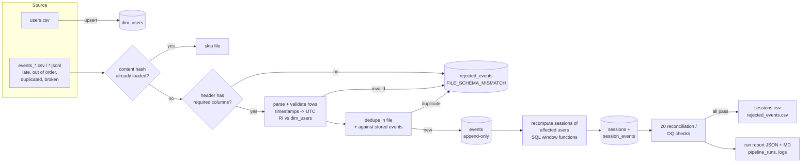

# Clickstream sessionization pipeline

Turns raw clickstream / application events into **user sessions using event-time inactivity gaps**
(default: a gap of more than 30 minutes starts a new session). It handles **out-of-order and late events,
duplicates, missing or broken timestamps, schema drift and boundary conditions**, quarantines every bad row
with its source file and line, is **safe to rerun**, and proves its output with reconciliation checks and
an independent comparison against generator ground truth.

* Language: **Python 3.11+ (standard library only) + SQL (SQLite, built into Python)**. Tests use `pytest`.
* Runs locally on Windows, macOS or Linux. No services, credentials or Docker needed.

---

## Quick start (clean environment)

```bash
git clone <this repo> && cd clickstream-sessionization
python -m venv .venv
# Windows: .venv\Scripts\activate      macOS/Linux: source .venv/bin/activate
pip install -r requirements-dev.txt     # only pytest; the pipeline itself has no dependencies

python -m pytest                        # 73 tests, ~2 s

# Run on the committed sample (426 rows, 2 batches, every edge case labelled)
python -m sessionize run --input data/sample/input/events --users data/sample/input/users.csv \
       --db output/warehouse.db --out output
python -m sessionize verify --db output/warehouse.db --expected data/sample/expected
python -m sessionize report --db output/warehouse.db        # sample analytical + ops queries
```

On Windows PowerShell put the command on one line (or replace `\` with `` ` ``).

Larger run (100,000 valid events, 106,500 input rows, 4 batches, fixed seed):

```bash
python -m sessionize generate --out data/large --profile large      # --events / --users / --seed to customise
python -m sessionize run --input data/large/input/events --users data/large/input/users.csv --db output/large.db --out output/large
python -m sessionize verify --db output/large.db --expected data/large/expected
python scripts/benchmark.py                 # performance measurement -> sample_output/benchmark.md
python scripts/demo.py                      # rerun / retry / late-data story -> sample_output/demo_transcript.md
```

Exit codes: `0` SUCCESS, `1` FAILED, `2` PARTIAL_SUCCESS (some file failed or was rejected), `3` DQ_FAILED.

---

## Architecture



Everything from "parse" to "recompute sessions" for one file runs in **one database transaction**.

| module | responsibility |
|---|---|
| [`sessionize/readers.py`](sessionize/readers.py) | CSV / JSONL readers that never crash on bad rows (they return them with an error + line number) |
| [`sessionize/validation.py`](sessionize/validation.py) | header check, per-row schema + business rules, normalization |
| [`sessionize/pipeline.py`](sessionize/pipeline.py) | orchestration, dedupe, transactions, idempotency, run/file logging, metrics |
| [`sql/sessionize.sql`](sql/sessionize.sql) + [`sessionize/transform.py`](sessionize/transform.py) | gap-based sessionization with `LAG` / running `SUM` window functions |
| [`sql/reconciliation.sql`](sql/reconciliation.sql) + [`sessionize/checks.py`](sessionize/checks.py) | PK, RI, count and rule checks — each query returns its number of violations |
| [`sessionize/publish.py`](sessionize/publish.py) | atomic CSV snapshots, JSON + markdown run report, JSON-lines run log |
| [`sessionize/generator.py`](sessionize/generator.py) | seeded data generator + separate expected answers |
| [`sessionize/expected.py`](sessionize/expected.py) | compares warehouse to the expected answers (`verify`) |
| [`sql/schema.sql`](sql/schema.sql) | all target DDL |
| [`config/default.toml`](config/default.toml) | gap, allowed event types, skew, timestamp policy, sessionize mode |

Full column-level documentation: **[docs/data_dictionary.md](docs/data_dictionary.md)**.
Decisions, trade-offs, failure modes, limitations: **[docs/design_notes.md](docs/design_notes.md)**.

---

## Schemas in one minute

**Source** event: `event_id` (key), `user_id` (FK to users), `event_type`, `event_ts` (ISO-8601), optional `page_url`, `device`.
**Source** users: `user_id` (key), optional `signup_ts`, `country`.

| target table | grain | key |
|---|---|---|
| `dim_users` | user | `user_id` |
| `events` (silver, append-only) | unique event | `event_id`; FK `user_id` |
| `rejected_events` (quarantine) | quarantined source line | `reject_id`; unique `(source_file_hash, source_line)` |
| `sessions` (gold) | user session | `session_id`; unique `(user_id, user_session_seq)` |
| `session_events` (gold bridge) | event → session | `event_id` |
| `pipeline_runs`, `file_ingestion_log`, `dq_check_results`, `pending_session_users` | ops | see dictionary |

### Sessionization rule

Per user, events are ordered by `(event_ts, event_id)`. A new session starts at the first event or when the gap to the
previous event is **strictly greater than** the configured gap (30 min). Exactly 30:00.000 stays in the session; 30:00.001
starts a new one. Sessions are not split at midnight. Timestamps with offsets (`+05:30`) are converted to UTC **before** gaps
are measured.

### Assumptions

* `event_id` is unique per event at the producer; re-sends keep the same id.
* A row without a usable event time cannot be sessionized correctly, so it is quarantined (never defaulted to load time).
* Timestamps without an offset are UTC (`naive_timestamp_policy = "reject"` turns that off).
* The users file is the authority for valid `user_id`s; it is upserted at the start of each run.
* For conflicting duplicates the stored / first-seen version is kept and the other copy quarantined for review.

---

## Data quality, idempotency and recovery

| requirement | how | test |
|---|---|---|
| malformed input | wrong field count / bad JSON → `MALFORMED_ROW` with raw content | `test_input_quality::test_malformed_*` |
| missing required field / missing timestamp | `MISSING_REQUIRED_FIELD`, `MISSING_EVENT_TS` | `test_missing_required_fields_and_missing_timestamp` |
| nulls in optional fields | empty → `NULL`, row accepted | same test, `test_malformed_jsonl` |
| invalid values | bad / date-only / future / ancient timestamps, unknown type, bad id | `test_invalid_values`, `test_future_rule_uses_reference_time_and_skew` |
| invalid reference key | `user_id` not in `dim_users` → `INVALID_USER_REF`; FK + DQ check | `test_reference_key_checked_against_users_file` |
| duplicate key / event | in file, across files, exact vs conflicting, same instant in other timezone | `tests/test_duplicates.py` (6 tests) |
| unexpected schema change | missing column → file rejected, others load; extra / reordered columns → accepted + `SCHEMA_DRIFT` warning | `test_missing_required_column_*`, `test_extra_and_reordered_columns_*` |
| empty batch | no files, header-only, zero-byte, blank JSONL | `test_no_input_files_*`, `test_header_only_and_zero_byte_files` |
| late / out-of-order data | per-user full recompute; late event can merge or extend sessions | `tests/test_sessionization_rules.py` |
| boundary conditions | gap = threshold, threshold + 1 ms, identical timestamps, midnight, timezones | `tests/test_sessionization_rules.py` |
| partial failure and retry | fault injected at 3 stages → file rolled back, run exit 2, retry succeeds | `test_failure_mid_file_rolls_back_and_retry_succeeds` |
| crash between commit and sessionization | crash-safe `pending_session_users` queue drained by next run | `test_crash_after_events_committed_*` |
| rerun of same input | content-hash skip; `--force` reprocess creates no duplicates, output byte-identical | `test_rerun_*`, `test_forced_rerun_*`, `test_renamed_copy_*` |
| deterministic transformation | same result regardless of file order; generator reproducible by seed | `test_result_is_independent_of_file_arrival_order`, `test_generator_is_deterministic_for_a_seed` |
| output correctness | 20 SQL checks; checks proven to catch injected corruption; end-to-end match with ground truth for 3 seeds | `tests/test_reconciliation_and_generator.py` |

**Rerun / restart / backfill behaviour**

* *Rerun:* files whose content hash was loaded (`SUCCESS`) or rejected (`REJECTED`) are skipped. Safe to run on a schedule over the same folder.
* *Restart after failure:* `FAILED` files are retried automatically; nothing from a failed file was committed.
* *Force:* `--force` reprocesses everything; rows already loaded from the same file+line are counted as `already_loaded`, nothing is duplicated.
* *Backfill:* put historical files in the input; affected users are recomputed. `--rebuild-sessions` recomputes all users (needed after changing the gap — a DQ check flags stale sessions).
* *Retry demo:* `SESSIONIZE_FAULT_INJECT=after_insert_events:batch_002` makes that file fail mid-transaction (stages: `after_validate`, `after_insert_events`, `after_sessionize`, `before_queued_sessionize`).

**Observability.** Every run writes a `pipeline_runs` row (run id, start/end, duration, input / inserted / duplicate /
already-loaded / rejected counts, users recomputed, sessions written, failed checks, failure reason, config, stage timings),
`file_ingestion_log` rows per file, `dq_check_results`, a JSON report `out/run_reports/<run_id>.json`, a readable
`out/reconciliation_report.md`, and a JSON-lines log `out/logs/<run_id>.log`.

Source-to-target reconciliation per file: `rows_read = inserted + duplicate + already_loaded + rejected`, checked in SQL and shown in the report.

---

## Sample data and evidence

| path | content |
|---|---|
| `data/sample/input/` | 25 users, 2 batch files, 426 rows: 400 valid events in 88 true sessions, 14 duplicates, 12 invalid rows (one per rule), 11 late events, `+05:30` / space-separated timestamps, exact-gap boundaries |
| `data/sample/expected/` | expected sessions, event→session map, labelled rejects (file, line, reason) — **kept apart from the input** |
| `sample_output/sessions.csv`, `rejected_events.csv` | published target after the demo |
| `sample_output/reconciliation_report.md` | counts + all DQ checks of the last run |
| `sample_output/validation_report.md` | pipeline vs expected answers: **PASS** (400/400 events, 88/88 sessions, 26/26 quarantined rows with the right reason) |
| `sample_output/demo_transcript.md` | load → verify → rerun → force → injected failure → retry → late merge → queries |
| `sample_output/test_results.txt` | `pytest -v` output |
| `sample_output/benchmark.md`, `benchmark_1m.md` | performance measurement |

Regenerate everything with `python -m sessionize generate --out data/sample --profile small` (seed 42), `python scripts/demo.py`
and `python scripts/benchmark.py`.

---

## Performance

Measured on the 100k profile (106,500 input rows, 5,000 users, 4 files) — see [`sample_output/benchmark.md`](sample_output/benchmark.md):

* Full pipeline incl. validation, load, sessionization, 20 checks and publish: **~6 s (~17k rows/s)**, single core.
* Profiling showed sessionization is the biggest cost: in the default `per_file` mode a user present in all 4 files is
  rebuilt 4 times (16k user recomputations for 5k users).
* **Optimization implemented and measured:** `sessionize_mode = "per_run"` queues affected users in each file's
  transaction and rebuilds each user once at the end: **1.4× faster** on 4 files (more with more files), identical output.
  It stays crash-safe because the queue is persistent.
* A small late batch recomputes only the touched users: **2.4× faster** than a full rebuild, identical output.
* At **1,000,000 events / 40 files** ([`benchmark_1m.md`](sample_output/benchmark_1m.md)): `per_file` 149 s vs
  `per_run` **66 s (2.25×, ~16k rows/s)** — the gain grows with the number of files per run.
* Next optimizations: scope the reconciliation checks to the users touched by the run (they are full-table today and
  dominate small incremental runs on a large warehouse: ~10 s at 1M events); validate files in parallel processes;
  move to DuckDB/Postgres for parallel window scans.

---

## Naming conventions

* Tables and columns: `snake_case`; layer visible in the name (`dim_`, plain fact names, `_log`, `_results`).
* Timestamps: `*_ts` = ISO-8601 UTC with ms (`2026-11-01T10:15:30.123Z`), `*_epoch_ms` = integer copy for arithmetic, `*_at` = audit time.
* IDs: `event_id` (source), `session_id` = `ses_<hash>`, `reject_id` = `rej_<hash>`, `run_id` = `run_<UTC time>_<random>`;
  every row carries `source_file` / `source_file_hash` / `source_line` and `run_id` lineage.
* Files: `events_batch_<nnn>.csv`; reason codes `UPPER_SNAKE_CASE`.

---

## Known limitations and next steps

See [docs/design_notes.md](docs/design_notes.md#limitations). In short: single-writer SQLite, no "session closed" watermark
for consumers that need frozen history, no maximum session length, rejected rows need a re-delivery to be replayed.

## Repository layout

```
sessionize/        pipeline package (python -m sessionize ...)
sql/               schema, sessionization, reconciliation and sample queries
config/            default.toml
tests/             73 pytest tests
data/sample/       small reproducible input + expected answers (separate)
sample_output/     outputs, reports, demo transcript, test results, benchmarks
scripts/           benchmark.py, demo.py
docs/              data dictionary, design notes
```
